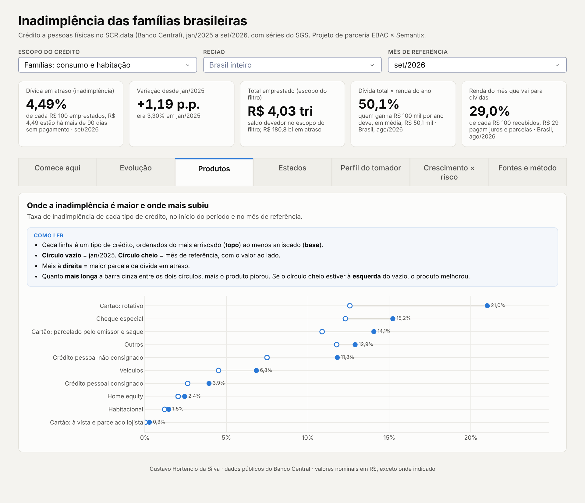
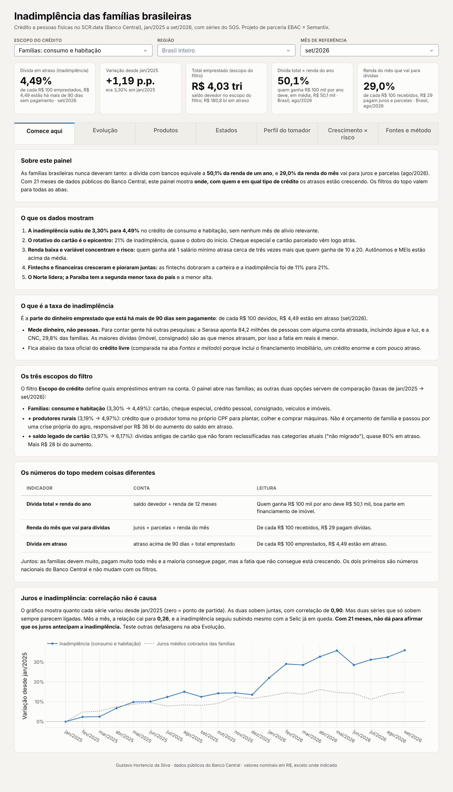
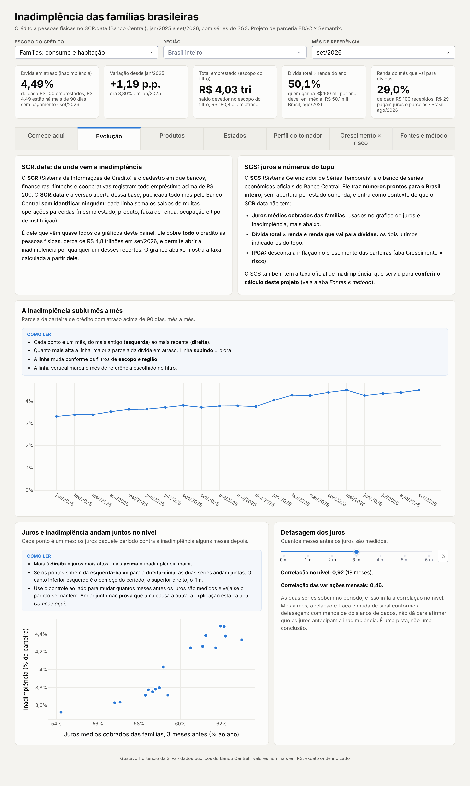
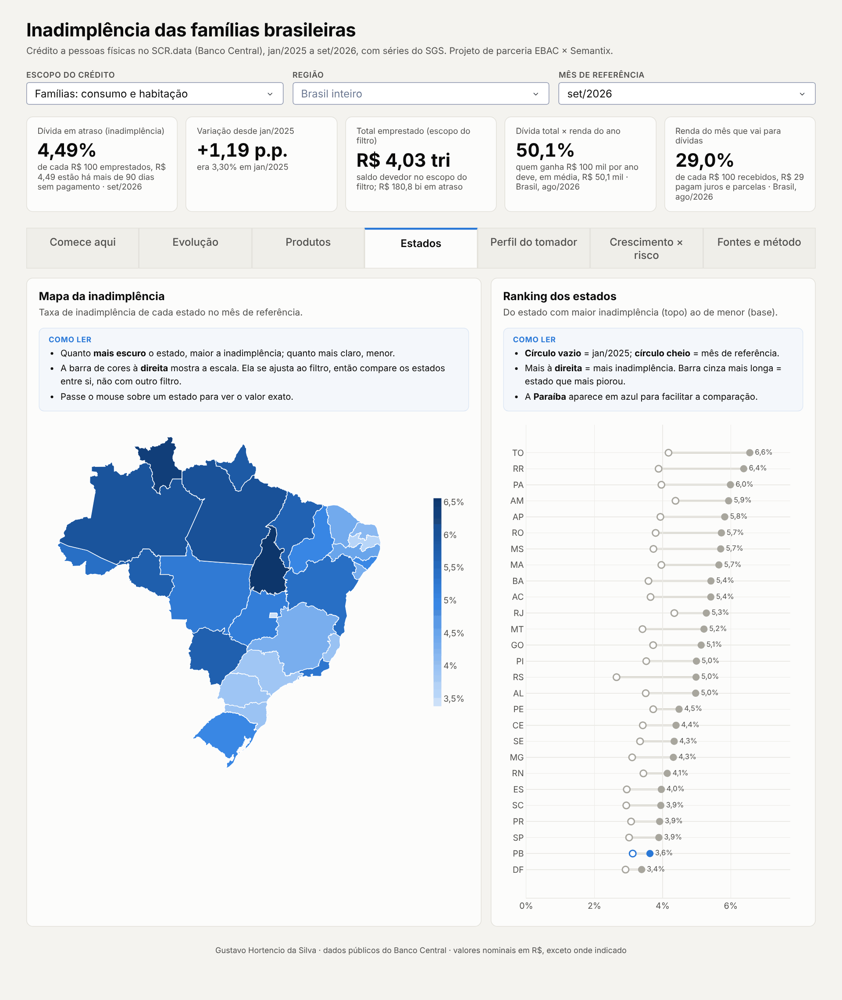
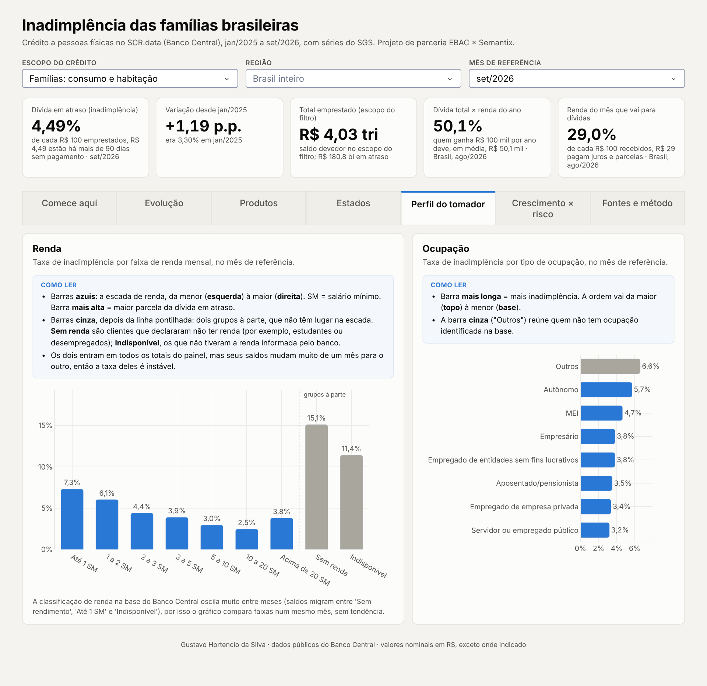
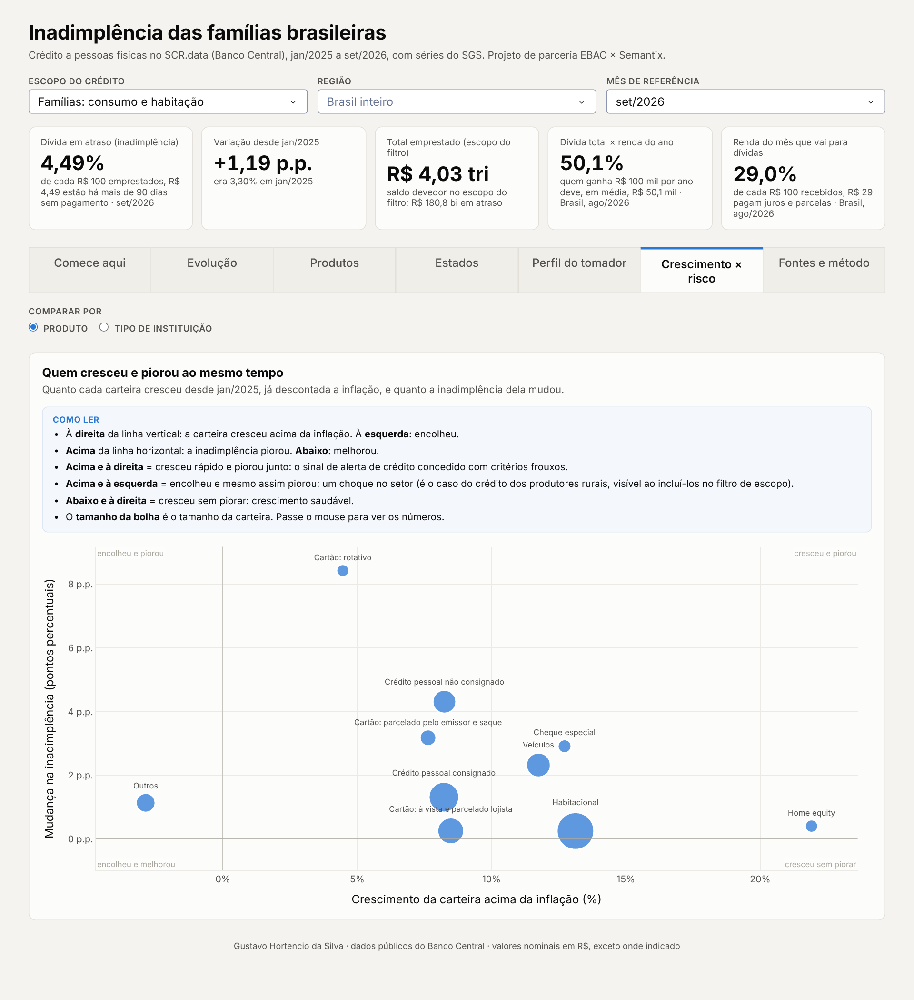
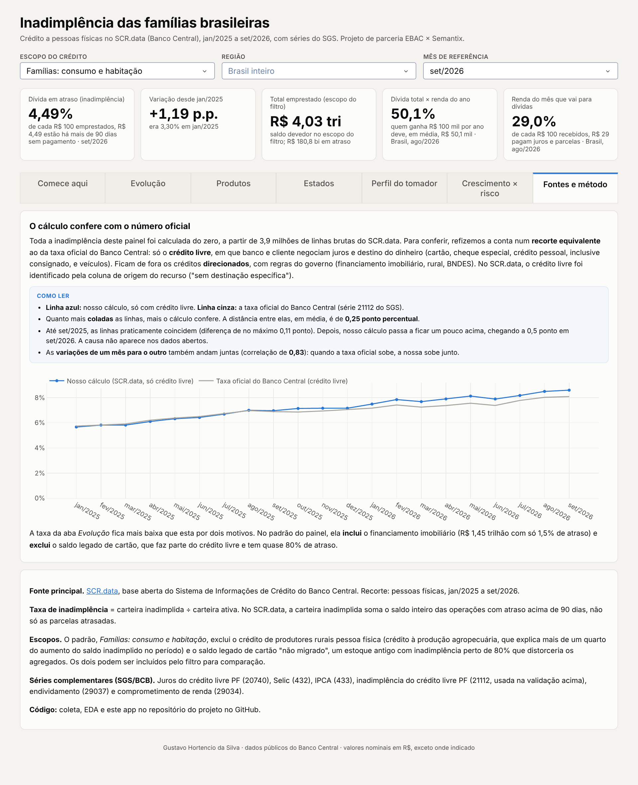

# Inadimplência das famílias brasileiras

*[English version](README.en.md)*

Análise de 21 meses de crédito a pessoas físicas no Brasil (jan/2025 a set/2026), com 3,9 milhões
de registros do **SCR.data** e nove séries do **SGS**, do Banco Central. Projeto de parceria
**EBAC × Semantix**.

**[Abrir o dashboard interativo](https://inadimplencia-familias-br.onrender.com)** · [Dashboard no Looker Studio](https://datastudio.google.com/reporting/863e566d-9912-46a7-b902-ac9d8ac9dbeb) · [Relatório de insights](docs/03_relatorio_insights.md)

> O dashboard roda no plano gratuito do Render: se ele estiver "dormindo", a primeira abertura leva
> cerca de 50 segundos.



## O problema

O endividamento das famílias chegou a 50,1% da renda em agosto/2026, e 29% da renda vai para o
pagamento de dívidas, os dois recordes da série do Banco Central. A pergunta do projeto é **onde,
com quem e em qual tipo de crédito** a inadimplência está crescendo, para que bancos e governo
possam agir de forma direcionada. [Dissertação completa](docs/01_dissertacao.md).

## Principais achados

| | |
|---|---|
| **3,97% → 6,17%** | inadimplência do crédito às pessoas físicas em 21 meses |
| **48%** | do aumento do saldo inadimplido vem do crédito a produtores rurais e de um estoque legado de cartão, não do consumo das famílias |
| **21%** | de inadimplência no rotativo do cartão (+8,4 p.p.), o produto mais arriscado |
| **3×** | a inadimplência de quem ganha até 1 salário mínimo em relação à faixa de 10 a 20 SM |
| **11% → 21%** | inadimplência nas fintechs, que dobraram a carteira de pessoas físicas |
| **3,6%** | Paraíba: segunda menor taxa do país e segunda menor alta (só o DF subiu menos) |

## O dashboard

O painel tem sete abas, todas com filtros de escopo do crédito, região e mês, e um quadro "Como
ler" em cada gráfico. Clique para ver cada uma:

<details><summary><b>Comece aqui</b>: o que é a taxa de inadimplência, os escopos e os principais achados</summary>


</details>

<details><summary><b>Evolução</b>: a taxa mês a mês e a relação com os juros</summary>


</details>

<details><summary><b>Estados</b>: mapa e ranking das UFs</summary>


</details>

<details><summary><b>Perfil do tomador</b>: renda e ocupação</summary>


</details>

<details><summary><b>Crescimento × risco</b>: quem cresceu e piorou ao mesmo tempo</summary>


</details>

<details><summary><b>Fontes e método</b>: validação do cálculo contra a série oficial</summary>


</details>

## Estrutura

```
├── app.py                     dashboard em Dash (publicado no Render)
├── src/
│   ├── coletar_dados.py       download do SCR.data e da API do SGS
│   ├── transformacao.py       regras de limpeza compartilhadas (produtos, regiões, escopos)
│   └── gerar_bases.py         bases agregadas para Looker Studio e dashboard
├── notebooks/
│   ├── 01_limpeza_e_preparacao.ipynb
│   └── 02_eda.ipynb
├── sql/consultas_eda.sql      consultas da EDA (DuckDB)
├── dados/agregados/           CSVs leves usados nas visualizações
└── docs/
    ├── 01_dissertacao.md
    ├── 02_fontes_e_coleta.md
    ├── 03_relatorio_insights.md
    ├── 04_roteiro_looker_studio.md
    └── documentacao_final.md  coleta, modelagem e conclusões
```

## Como reproduzir

```bash
python -m pip install -r requirements-analise.txt
python src/coletar_dados.py       # baixa ~300 MB do Banco Central
python src/gerar_bases.py         # gera dados/agregados/
jupyter notebook notebooks/       # EDA
python app.py                     # dashboard em http://127.0.0.1:8050
```

Os dados brutos (`dados/scr_pf/`, `dados/zips/`) ficam fora do Git; o repositório guarda só os
agregados.

## Ferramentas

Python (pandas, DuckDB, matplotlib, Plotly, Dash), SQL, Parquet, Looker Studio, Render.

## Fontes

- [SCR.data, Banco Central do Brasil](https://dadosabertos.bcb.gov.br/dataset/scr_data)
- [SGS, Sistema Gerenciador de Séries Temporais](https://www3.bcb.gov.br/sgspub/)

---

Gustavo Hortencio da Silva · economista (UFPB) · [LinkedIn](https://www.linkedin.com/in/gustavo-hortencio) · [GitHub](https://github.com/gstvhortencio)
